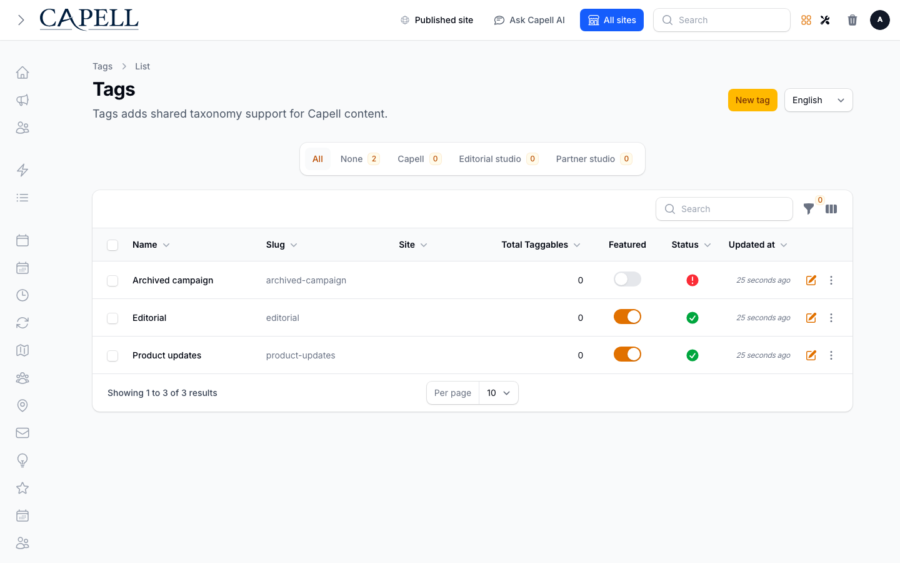
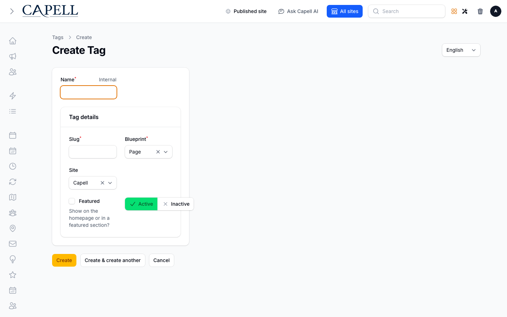

# Tags

<!-- prettier-ignore-start -->

## What It Does

Tags adds site-scoped, multilingual taxonomy records and polymorphic tag assignments for pages and package-owned content.

- **Price and availability:** Check current availability and price on the [Capell Marketplace listing](https://capell.app/extensions/tags).
- **Licence:** Check the licence terms on the [Capell Marketplace listing](https://capell.app/extensions/tags).
- **Requires:** `PHP ^8.4`, `capell-app/admin ^1.0.66`, `capell-app/core ^1.0.66`, `capell-app/navigation ^1.0`, `filament/spatie-laravel-tags-plugin ^5.7.6`.
- **Install:** `composer require capell-app/tags`.

Admins create and edit tags, assign them to supported content, inspect usage, and merge duplicates from the Tags resource and page actions.

## Who It Is For

**For developers:** The HasTags concern and focused Actions give content packages a shared taxonomy boundary without duplicating pivot models or assignment logic.

**For teams:** Editors can group content consistently and merge duplicate labels before the taxonomy becomes difficult to browse or filter.

## Quick Start

1. Install the package: `composer require capell-app/tags`.
2. Run the package setup: `php artisan capell:tags-install`.
3. Open the package admin surface at `/admin/tags` and confirm Tags is available.

## Configure

- **Commands:** `php artisan capell:tags-install`.

## Limits And Pitfalls

- Install the required Capell packages at the versions in `composer.json`: `capell-app/admin ^1.0.66`, `capell-app/core ^1.0.66`, `capell-app/navigation ^1.0`.
- Run migrations before opening package resources or public routes.
- Custom write integrations must preserve invalidation for `tags` cache tags.

## Screens And Workflow

- Tags admin index (admin).
- Create/edit tag form (admin).
- Tag relation manager showing tagged pages (admin).
- Article or page form using TagsInput (admin).

## Install Impact

- Required packages: `capell-app/admin`, `capell-app/core`, `capell-app/navigation`.
- Admin navigation: declares `admin-resource: TagResourceContribution`; each Filament page or resource controls its own navigation visibility.
- Admin/editor extensions: none declared.
- Permissions: `ViewAny:Tag`, `View:Tag`, `Create:Tag`, `Update:Tag`, `Delete:Tag`, `DeleteAny:Tag`, `Restore:Tag`, `RestoreAny:Tag`, `ForceDelete:Tag`, `ForceDeleteAny:Tag`, `Replicate:Tag`, `Reorder:Tag`; access also governed by package policies: `TagPolicy`.
- Public routes: none declared.
- Database changes: package migrations are declared.
- Config: no package config files.
- Settings: no package settings declared.
- Queues or schedules: none declared.
- Cache tags: `tags`.
- Commands: `capell:tags-install`.

## Troubleshooting

| Symptom | Likely cause | Check | Fix |
| --- | --- | --- | --- |
| Package surface is missing after install | Provider or manifest is not loaded | Confirm `capell.json`, package `composer.json`, and provider registration | Reinstall the package, refresh Composer autoload, and clear host caches |
| Admin screen or command fails on missing table | Package migrations have not run | Check the tables listed in `Data Model` | Run host migrations and rerun the focused package test |

## Upgrading

No manual steps between minor versions.

Read [CHANGELOG.md](CHANGELOG.md) before upgrading.

## Next Steps

- [Package docs](docs/README.md)
- [Overview](docs/overview.md)
- [Worked extension examples](docs/extension-contracts.md)
- [Admin guide](docs/admin-guide.md)
- [Troubleshooting](#troubleshooting)
- [Developer reference](docs/reference.md)
- [Marketplace assets](docs/assets/marketplace/)
- [Capell content language plan](../../docs/CONTENT_LANGUAGE_PLAN.md)
- [Capell documentation design system](../../docs/DESIGN_SYSTEM.md)
- [Capell and package ERD notes](../../docs/erd/capell-and-package-erds.md)
- Related packages: [Navigation](../navigation/README.md), [Publishing Studio](../publishing-studio/README.md).

<!-- prettier-ignore-end -->
