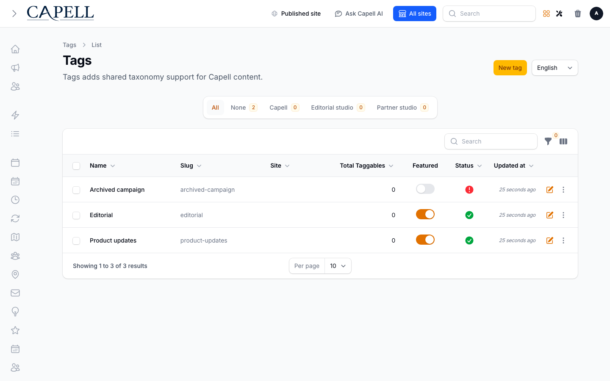
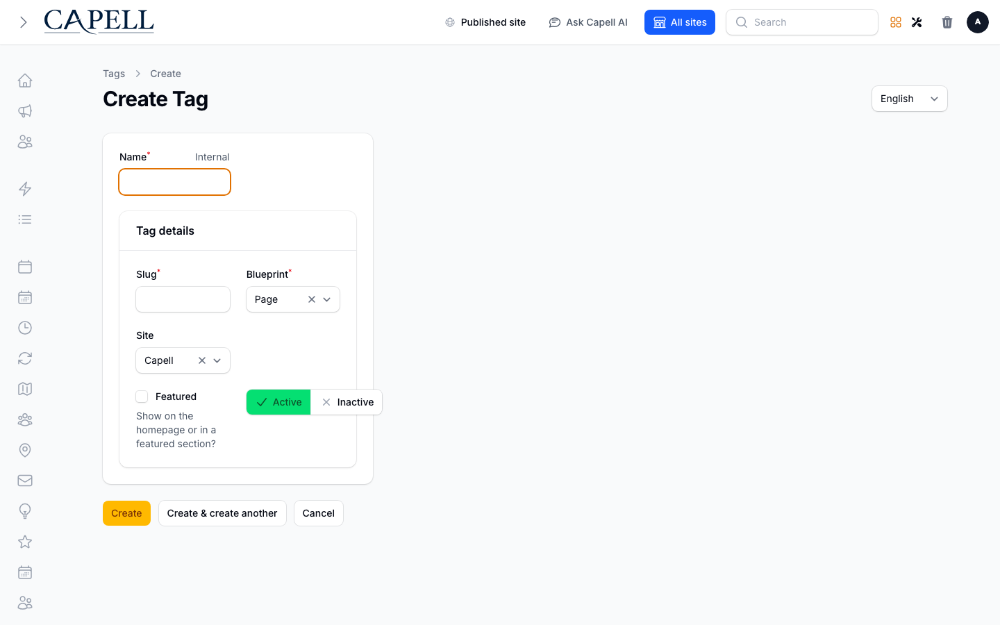

# Tags

<!-- prettier-ignore-start -->

Your tag list has SEO, search engines and search optimisation in it, and all three mean the same thing. Tick them in the list, choose Merge tags and pick the one to keep. Capell shows how many pages and articles will change before you confirm, and everything that carried an old tag then carries the kept one.

Each tag has a name and a web address, and it belongs to one site or is shared across sites. Site editors can see shared tags but change only their own site's. Tags can be merged when they are the same type and belong to the same site, or are all shared. Tags shows visitors nothing itself, so public tag pages come from Blog, Capell's blogging package. With Blog installed, a visitor who follows an old tag's address reaches the kept tag's page. Deleting a tag is permanent.

In the Pages list, select any number of pages and choose Manage tags to add or remove tags across all of them at once. Click a tag's usage count to see which pages and articles carry it, grouped by site.

- **Price and availability:** Check current availability and price on the [Capell Marketplace listing](https://capell.app/marketplace/extensions/tags).
- **Licence:** Check the licence terms on the [Capell Marketplace listing](https://capell.app/marketplace/extensions/tags).
- **Requires:** `PHP ^8.4`, `capell-app/admin ^1.0.78`, `capell-app/core ^1.0.66`, `filament/spatie-laravel-tags-plugin ^5.7.6`.
- **Install:** `composer require capell-app/tags`.

## Quick Start

1. Install the package: `composer require capell-app/tags`.
2. Run the package setup: `php artisan capell:tags-install`.
3. Open the package admin surface at `/admin/tags` and confirm Tags is available.

## For Developers

The HasTags concern and focused Actions give content packages a shared taxonomy boundary without duplicating pivot models or assignment logic.

## Configure

- **Commands:** `php artisan capell:tags-install`.

## Limits And Pitfalls

- Install the required Capell packages at the versions in `composer.json`: `capell-app/admin ^1.0.78`, `capell-app/core ^1.0.66`.
- Run migrations before opening package resources or public routes.
- Custom write integrations must preserve invalidation for `tags` cache tags.

## Screens And Workflow

- Tags admin index (admin).
- Create/edit tag form (admin).
- Tag relation manager showing tagged pages (admin).
- Article or page form using TagsInput (admin).

## Install Impact

- Required packages: `capell-app/admin`, `capell-app/core`.
- Admin navigation: declares `admin-resource: TagResourceContribution`; each Filament page or resource controls its own navigation visibility.
- Admin/editor extensions: none declared.
- Permissions: `ViewAny:Tag`, `View:Tag`, `Create:Tag`, `Update:Tag`, `Delete:Tag`, `DeleteAny:Tag`, `Replicate:Tag`; access also governed by package policies: `TagPolicy`.
- Public routes: none declared.
- Database changes: package migrations are declared.
- Config: no package config files.
- Settings: no package settings declared.
- Queues or schedules: none declared.
- Cache tags: `tags`.
- Commands: `capell:tags-install`.

## Troubleshooting

| Symptom | Likely cause | Check | Fix |
| --- | --- | --- | --- |
| Package surface is missing after install | Provider or manifest is not loaded | Confirm `capell.json`, package `composer.json`, and provider registration | Reinstall the package, refresh Composer autoload, and clear host caches |
| Admin screen or command fails on missing table | Package migrations have not run | Check the tables listed in `Data Model` | Run host migrations and rerun the focused package test |

## Upgrading

No manual steps between minor versions.

Read [CHANGELOG.md](CHANGELOG.md) before upgrading.

## Next Steps

- [Package docs](docs/README.md)
- [Overview](docs/overview.md)
- [Worked extension examples](docs/extension-contracts.md)
- [Admin guide](docs/admin-guide.md)
- [Troubleshooting](#troubleshooting)
- [Developer reference](docs/reference.md)
- [Marketplace assets](docs/assets/marketplace/)
- [Capell content language plan](../../docs/CONTENT_LANGUAGE_PLAN.md)
- [Capell documentation design system](../../docs/DESIGN_SYSTEM.md)
- [Capell and package ERD notes](../../docs/erd/capell-and-package-erds.md)
- Related packages: [Publishing Studio](../publishing-studio/README.md).

<!-- prettier-ignore-end -->
